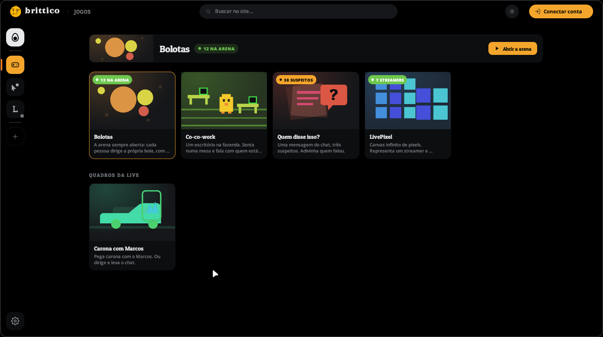
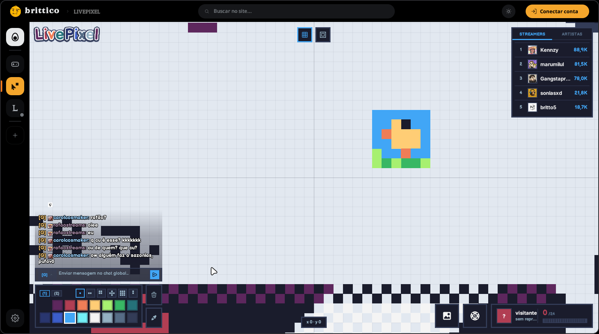

<div align="center">


# Brittico

**O feed, a call e o LoL de proximidade num app só.**
<br>O [brittico.xyz](https://brittico.xyz) como programa: nativo, leve e feito em Rust.

[](https://github.com/britto64/brittico-app/releases/latest)
[](https://github.com/britto64/brittico-app/releases)
[](https://github.com/britto64/brittico-app/actions/workflows/build.yml)
<br>
[](#windows)
[](#linux)
[](https://www.rust-lang.org)
[](https://github.com/emilk/egui)

[**Baixar**](https://github.com/britto64/brittico-app/releases/latest) · [Página do app](https://brittico.xyz/app/) · [Relatar um problema](https://github.com/britto64/brittico-app/issues)

 

</div>

## O que tem

| | |
|---|---|
| 🎙️ **Call** | Voz limpa (ruído e eco saem sozinhos), mostrar a tela em **Qualidade** (1080p) ou **Fluidez** (60 fps), Call Presidencial e atalhos de mutar. |
| 🎯 **LoL de proximidade** | O app lê o minimapa da partida e ajusta o volume de cada aliado pela distância. Chegou junto, a voz sobe. Foi para outra rota, ela some. |
| 🟦 **LivePixel** | O quadro de pixels do chat, com pincéis, cores, placar e chat. |
| 📰 **Feed e perfil** | O feed do site, os posts, os votos e o seu perfil. |
| 🎨 **Temas** | Claro, escuro e as paletas do site, iguais às do brittico.xyz. |

## Instalar

Todos os arquivos estão na [última versão](https://github.com/britto64/brittico-app/releases/latest).

### Windows

| Arquivo | Para quem |
|---|---|
| [**Brittico-Setup-x64.exe**](https://github.com/britto64/brittico-app/releases/latest/download/Brittico-Setup-x64.exe) | Quase todo mundo. Instala em segundos, sem pedir administrador, e pergunta se cria o atalho e se o Brittico abre junto com o Windows. |
| [Brittico-portable-x64.exe](https://github.com/britto64/brittico-app/releases/latest/download/Brittico-portable-x64.exe) | Quem não quer instalar: é só abrir. |

Windows 10 ou 11, 64 bits. Para atualizar, rode o instalador novo por cima. Para remover, use
*Configurações → Aplicativos*.

> [!NOTE]
> O instalador ainda não é assinado digitalmente. Na primeira vez, o Windows pode mostrar
> "O Windows protegeu o computador": clique em **Mais informações → Executar assim mesmo**.
> Para conferir que o arquivo é este mesmo, compare com o `SHA256SUMS.txt` da versão.

### Linux

**AppImage** (qualquer distribuição):

```sh
chmod +x Brittico-x86_64.AppImage
./Brittico-x86_64.AppImage
```

**Arch Linux, Manjaro, EndeavourOS:**

```sh
sudo pacman -U brittico-x86_64.pkg.tar.zst
```

Ou monte você mesmo com o [`PKGBUILD`](packaging/arch/PKGBUILD) (`makepkg -si`).

**Debian, Ubuntu, Mint, Pop!_OS:**

```sh
sudo apt install ./brittico_amd64.deb
```

**Fedora, openSUSE:**

```sh
sudo dnf install ./brittico-x86_64.rpm
```

**Qualquer outra** ([`.tar.gz`](https://github.com/britto64/brittico-app/releases/latest/download/brittico-linux-x86_64.tar.gz)):

```sh
tar xzf brittico-linux-x86_64.tar.gz
./brittico/usr/bin/brittico
```

Precisa de uma distribuição de 2022 para cá (glibc 2.35, OpenSSL 3). Para mostrar a tela na Call, o
sistema precisa do `xdg-desktop-portal` e do PipeWire, que já vêm nas distribuições atuais.

## Compilar

```sh
git clone https://github.com/britto64/brittico-app
cd brittico-app
cargo run --release
```

Precisa do Rust estável. No Linux, também dos pacotes de desenvolvimento da GLib, da ALSA e do OpenSSL
(no Ubuntu: `libglib2.0-dev libasound2-dev libssl-dev pkg-config`). O `.exe` também pode ser gerado a
partir do Linux com o [`build-windows.sh`](build-windows.sh).

As versões publicadas saem do [GitHub Actions](.github/workflows/build.yml): cada tag `v*` compila no
Windows e no Linux, monta os pacotes e publica a Release com as somas SHA-256 e a atestação de origem
de cada arquivo.

Os detalhes de desenvolvimento (telas de teste, roteiros de clique, comparar com o site) estão em
[`docs/DESENVOLVIMENTO.md`](docs/DESENVOLVIMENTO.md).
